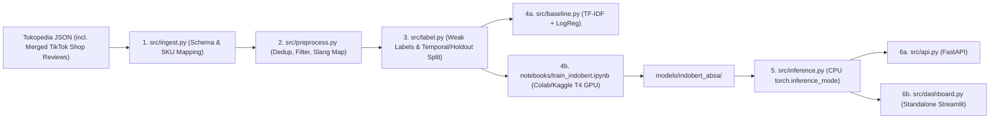

# Cozmeed Outdoor Gear Aspect-Based Sentiment Analysis (`cozmeed-absa`)

## Problem Statement

E-commerce star ratings on Indonesian marketplaces routinely mask actionable product defects and logistics bottlenecks. Verified buyers often leave a **5-star** overall rating out of seller politeness while embedding specific complaints in their Indonesian review text (e.g., weak zipper stitching, tight shoulder straps, or slow courier handling).

`cozmeed-absa` is an end-to-end **Aspect-Based Sentiment Analysis (ABSA)** pipeline built for **Cozmeed** outdoor gear reviews spanning all four core product lines (`backpack`, `jacket`, `apparel`, `vest_accessories`, plus `other` for unmatched SKUs). **Tokopedia (including merged TikTok Shop reviews)** serves as the single production ingestion source (targeting **2,500–3,000 reviews across 15–20 high-volume Cozmeed SKUs**). Each review is scored independently across four operational aspects (`Positive`, `Negative`, or `None`) so product and operations teams can surface negative aspect signals even inside 4- and 5-star reviews.

> [!NOTE]
> **Ingestion Engineering Trade-Off (Shopee Dropped):** Live Shopee `get_ratings` fetching was prototyped and intentionally dropped during ingestion engineering because Shopee enforces rotating client-side anti-bot signature walls (`error=90309999` / per-request `x-sap-sec`). Standardizing on Tokopedia (`productReviewList`, which also includes merged TikTok Shop buyer reviews) provides reliable, reproducible pagination without brittle browser-signature workarounds. `parse_shopee_reviews` remains available in `src/ingest.py` strictly for offline/manual exports if needed.

---

## Pipeline Architecture



---

## Unified Data Schema & Aspect Taxonomy

### Unified Review Schema

Production records ingested from Tokopedia (`productReviewList`)—and any optional offline Shopee exports—map to the following contract:

| Column | Type | Constraints / Description |
| :--- | :--- | :--- |
| `review_id` | `str` | Platform-prefixed identifier (`tokped_<id>`; offline `shopee_<cmtid>`) |
| `platform` | `str` | `"tokopedia"` (single production source; `"shopee"` retained for offline exports) |
| `product_name` | `str` | Cleaned Cozmeed SKU name resolved via `data/tokopedia_products.json` (with filename fallback) |
| `variant_name` | `str \| None` | Optional variant/size metadata (`variantName`, e.g., `Hitam - L/XL`) for size-specific `fit_comfort` analysis |
| `category` | `str` | One of `["backpack", "jacket", "apparel", "vest_accessories", "other"]` matched via `data/category_rules.json` priority order |
| `rating` | `int` | Star rating `1` through `5` (`productRating` on Tokopedia) |
| `review_text` | `str` | Raw review text with HTML entities decoded, before slang normalization |
| `created_at` | `str` | ISO-8601 UTC timestamp (`YYYY-MM-DDTHH:MM:SSZ`) |

### 4-Aspect × 3-Class Taxonomy

Each review is classified independently across four aspects using `{Positive, Negative, None}`:

| Aspect Key | Operational Scope |
| :--- | :--- |
| `material_durability` | Fabric quality, stitching strength, zippers, waterproofing, weight/durability |
| `fit_comfort` | Sizing accuracy, backsystem ergonomics, breathability, strap comfort |
| `price_value` | Affordability, perceived value for money |
| `shipping_seller` | Delivery speed, packaging safety, seller responsiveness |

---

## Environment Constraints & Setup

- **Package Manager:** Exclusively `uv` (`pyproject.toml` + `uv.lock`). Do not use `pip install` or Conda.
- **No Docker:** Local disk footprint is kept strictly `< 2.5 GB`.
- **CPU-Only Local Runtime:** `torch` is pinned to the `pytorch-cpu` index in `pyproject.toml`. GPU fine-tuning runs exclusively in `notebooks/train_indobert.ipynb` on Google Colab / Kaggle T4.

### Installation & Verification

```bash
# Install dependencies into .venv using the CPU-only PyTorch index
uv sync

# Run unit and smoke tests
uv run pytest

# Lint with Ruff
uv run ruff check src tests
```

### Fetching Raw Reviews (`src/fetch.py`)

Copy `.env.example` to `.env` and populate `TOKOPEDIA_COOKIE` before fetching (`.env` is gitignored and must never be committed). Register every `productID -> Full Cozmeed Product Name` pair in `data/tokopedia_products.json` across `backpack`, `jacket`, `apparel`, and `vest_accessories` so `src.ingest` classifies all SKUs cleanly without falling back to `"other"`:

```bash
# 1. Create local secrets file from template
cp .env.example .env

# 2. Auto-discover Cozmeed's full Tokopedia catalog into data/tokopedia_products.json
uv run python -m src.fetch --discover-catalog --products-file data/tokopedia_products.json

# 3. Fetch balanced reviews across all 4 categories (saves data/raw/tokopedia_<productID>_page_<page>.json)
uv run python -m src.fetch --platform tokopedia --products-file data/tokopedia_products.json --balance-categories --skip-existing --max-pages 35 --target-reviews 5200

# Or fetch explicit product IDs directly
uv run python -m src.fetch --platform tokopedia --product-ids 100291091620 --max-pages 30
```

- Requests pause for a randomized `2.0–4.0s` delay between pages and stop gracefully without losing saved pages if Tokopedia returns HTTP `403`/`429` or GraphQL errors.
- If a requested `productID` is an alias that resolves to a different canonical `productID` in the response, `src/fetch.py` logs a warning so duplicate SKU pulls are spotted immediately.

### ETL, Preprocessing, & Splitting (`src/ingest.py`, `src/preprocess.py`, `src/label.py`)

```bash
# Stage 1: Ingest raw Tokopedia JSON exports into the unified Parquet schema
uv run python -m src.ingest --raw-dir data/raw --output data/processed/reviews_unified.parquet

# Stage 2: Deduplicate, filter low-information filler (< 4 words), normalize slang, and write audit report
uv run python -m src.preprocess --input data/processed/reviews_unified.parquet --output data/processed/reviews_clean.parquet

# Stage 3a: Stratified sample (~650 rows), bootstrap weak aspect labels, and export annotation_sheet.csv + docs/annotation.md
uv run python -m src.label --bootstrap --input data/processed/reviews_clean.parquet --output data/labeled/annotation_sheet.csv --sample-size 650

# Stage 3b: Validate verified annotations and write 80/20 temporal train.parquet / test.parquet splits
uv run python -m src.label --build-split --annotation-csv data/labeled/annotation_sheet.csv --output-dir data/labeled
```

**Leakage-Free Evaluation Splits (`src/label.py`):**
- **Temporal Split (Recommended):** Trains on earlier reviews (e.g., 2024 – mid-2026) and evaluates on the newest late-2026 reviews to measure resilience to production language/product drift while keeping identical normalized review templates in a single partition.
- **Product-Holdout Split:** Trains on `backpack`, `jacket`, and `apparel`, and evaluates on an unseen gear line (default: `vest_accessories`) to verify the model learns generalizable outdoor-gear aspect cues rather than memorizing product titles.

### Serving Commands (Once Models Are Trained)

```bash
# Run decoupled FastAPI service
uv run fastapi dev src/api.py

# Run standalone Streamlit dashboard
uv run streamlit run src/dashboard.py
```

---

## Evaluation Results (Baseline vs. IndoBERT)

*Metrics will be populated once Stage 4 (`src/baseline.py` and `indobenchmark/indobert-base-p1`) evaluation completes.*

| Model | Overall Macro-F1 | `material_durability` F1 | `fit_comfort` F1 | `price_value` F1 | `shipping_seller` F1 | `Negative` F1 / Recall (5-Star Reviews) |
| :--- | :---: | :---: | :---: | :---: | :---: | :---: |
| TF-IDF + Logistic Regression (`src/baseline.py`) | *Pending Stage 4 evaluation* | *Pending Stage 4 evaluation* | *Pending Stage 4 evaluation* | *Pending Stage 4 evaluation* | *Pending Stage 4 evaluation* | *Pending Stage 4 evaluation* |
| IndoBERT (`indobenchmark/indobert-base-p1`) | *Pending Stage 4 evaluation* | *Pending Stage 4 evaluation* | *Pending Stage 4 evaluation* | *Pending Stage 4 evaluation* | *Pending Stage 4 evaluation* | *Pending Stage 4 evaluation* |

---

## Error Analysis (Indonesian Slang & Sarcasm)

*Concrete misclassifications (3–5 Indonesian slang/sarcasm examples) will be documented here and in `docs/evaluation.md` after Stage 4 evaluation.*

| Review Excerpt | Star Rating | Aspect | Gold Label | Predicted Label | Failure Mode |
| :--- | :---: | :--- | :---: | :---: | :--- |
| *Pending Stage 4 evaluation* | — | — | — | — | — |

---

## Deployment Architecture

- **Streamlit Community Cloud:** `src/dashboard.py` imports `src/inference.py` directly and runs standalone without requiring a separate FastAPI background process.
- **FastAPI Microservice:** `src/api.py` exposes `POST /predict` and `POST /predict/batch` using a singleton `AspectSentimentPredictor` loaded once at startup with `torch.inference_mode()` on `device="cpu"`.
- Detailed data contracts and trade-offs are documented in [docs/architecture.md](docs/architecture.md).

---

## License & Data Disclaimer

- **Code License:** This repository's original pipeline code (`src/`, `notebooks/`, `tests/`) is released under the [MIT License](LICENSE). The base pretrained model (`indobenchmark/indobert-base-p1`) is also MIT-licensed.
- **Data Disclaimer:**

> The MIT License applies strictly to the source code and model architecture in this repository. Any included sample review data was collected from publicly accessible Tokopedia product pages for non-commercial educational and portfolio demonstration purposes only.

