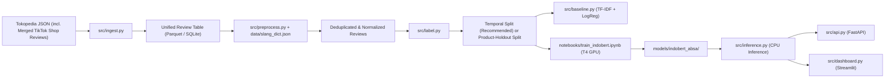

# System Architecture — Cozmeed ABSA

## 1. Objective & Problem Context

Marketplace star ratings (`1–5`) are coarse aggregates that frequently conceal product quality issues. Using **Tokopedia (including merged TikTok Shop reviews)** as the single production ingestion source across 15–20 Cozmeed SKUs (`2,500–3,000` target reviews spanning `backpack`, `jacket`, `apparel`, and `vest_accessories`), buyers commonly award `5` stars when delivery is fast while noting defects in the text (e.g., *"pengiriman cepat tp resleting agak seret"* or *"Sz XL nya kecil, di punggung sy terlalu kecil"*). `cozmeed-absa` decomposes each review into four independent 3-class predictions (`Positive`, `Negative`, `None`) to detect hidden negative aspect signals across Cozmeed's outdoor gear catalog.

> **Ingestion Scope Decision:** Live Shopee `get_ratings` fetching was dropped during ingestion prototyping due to rotating client-side anti-bot signature walls (`error=90309999` / per-request `x-sap-sec`). Standardizing on Tokopedia (which surfaces merged TikTok Shop buyer feedback) keeps collection reliable and reproducible without bypassing anti-bot signatures. `parse_shopee_reviews` remains in `src/ingest.py` strictly for offline/manual exports.

---

## 2. End-to-End Data Flow

### Stage Breakdown

0. **Raw Collection (`src/fetch.py` + `.env.example`):** Auto-discovers Cozmeed's Tokopedia catalog (`ShopProducts` GraphQL, retaining items with `stats.reviewCount == 0` and prioritizing `"terjual"` badges) into `data/tokopedia_products.json`, then pulls balanced paginated Tokopedia (`productReviewList`) JSON exports into `data/raw/` with randomized delays, `totalReviews == 0` / canonical alias skipping, and graceful halting on HTTP `403`/`429`.
1. **Ingestion (`src/ingest.py`):**
   - **Tokopedia (`productReviewList`, Production Source):** Parses the GraphQL batch JSON list, resolves `productID -> product_name` via `data/tokopedia_products.json` (with source filename fallback), HTML-unescapes `message` and `variantName`, extracts `productRating`, and converts `reviewCreateTime` Unix epoch strings to ISO-8601 UTC.
   - **Shopee (`get_ratings`, Offline Fallback Only):** Retained in `parse_shopee_reviews` for manually exported files (`cmtid`, `rating_star`, `product_items[0]`), while automated Shopee fetching is retired.
   - **SKU-to-Category Classification:** Evaluates lowercased `product_name` against `data/category_rules.json` using `priority_order` (`vest_accessories` -> `jacket` -> `apparel` -> `backpack`). Unmatched SKUs map to `"other"` and emit a summary warning listing all unmatched `product_name` values and counts.
2. **Preprocessing (`src/preprocess.py`):**
   - Drops exact duplicates on `(platform, review_text, product_name)`.
   - Filters empty reviews and low-information filler containing fewer than 4 words after stripping punctuation and emojis.
   - Normalizes Indonesian e-commerce abbreviations using the explicit external JSON dictionary in `data/slang_dict.json`, preserving raw `review_text` alongside `normalized_text`.
   - Logs exact row counts retained and dropped at each stage to stdout and `docs/data_pipeline.md`.
3. **Labeling & Splitting (`src/label.py`):**
   - Selects a stratified sample (~650 rows: all 1–3 star reviews plus longest 4–5 star reviews), pre-populates clause-aware Indonesian weak aspect labels, exports `data/labeled/annotation_sheet.csv`, and documents counts in `docs/annotation.md`.
   - Validates verified gold labels (`--build-split`) and enforces two leakage-free evaluation regimes replacing cross-platform splits: **Temporal Split** (oldest 80% -> `train.parquet`, newest 20% -> `test.parquet`, grouping identical templates) and **Product-Holdout Split** (train on `backpack`/`jacket`/`apparel`, eval on unseen `vest_accessories`).
4. **Baseline & Fine-Tuning (`src/baseline.py`, `notebooks/train_indobert.ipynb`):**
   - Trains a multi-aspect TF-IDF + Logistic Regression baseline locally first to establish minimum Macro-F1 benchmarks.
   - Fine-tunes `indobenchmark/indobert-base-p1` on Colab/Kaggle T4 GPU and exports serialized weights to `models/indobert_absa/`.
5. **CPU Inference (`src/inference.py`):**
   - Loads serialized model weights once at startup on `device="cpu"` and executes forward passes inside `torch.inference_mode()`.
6. **Serving (`src/api.py`, `src/dashboard.py`):**
   - `src/api.py` provides `POST /predict` and `POST /predict/batch` endpoints via FastAPI.
   - `src/dashboard.py` provides an interactive Streamlit dashboard calling `src/inference.py` directly.

---

## 3. Schema Contracts

### Unified Review Table

| Field | Type | Required | Validation Rule |
| :--- | :--- | :---: | :--- |
| `review_id` | `str` | Yes | Unique, prefixed `tokped_<id>` (or `shopee_<cmtid>` for offline exports) |
| `platform` | `str` | Yes | `"tokopedia"` (production source; `"shopee"` offline fallback) |
| `product_name` | `str` | Yes | Non-empty cleaned SKU name |
| `variant_name` | `str \| None` | No | Nullable product variant/size (`variantName` / `model_name`) |
| `category` | `str` | Yes | Enum: `"backpack"`, `"jacket"`, `"apparel"`, `"vest_accessories"`, `"other"` |
| `rating` | `int` | Yes | Integer in `[1, 5]` |
| `review_text` | `str` | Yes | Raw review text (HTML entities unescaped) before normalization |
| `created_at` | `str` | Yes | ISO-8601 UTC timestamp string (`YYYY-MM-DDTHH:MM:SSZ`) |

### Aspect Label Contract

Every labeled or predicted sample contains one sentiment value in `{"Positive", "Negative", "None"}` for each of:
- `material_durability`
- `fit_comfort`
- `price_value`
- `shipping_seller`

---

## 4. Key Design Trade-Offs

| Decision | Chosen Approach | Rationale & Trade-Off |
| :--- | :--- | :--- |
| **Local PyTorch Index** | CPU-only `pytorch-cpu` wheel via `uv` | Keeps local environment strictly `< 2.5 GB` without CUDA bloat; offloads GPU training to Colab/Kaggle T4. |
| **No Docker** | Native `uv` virtual environment | Avoids multi-GB container images and aligns with Streamlit Community Cloud standalone deployment. |
| **Decoupled Serving** | `src/api.py` and `src/dashboard.py` both import `src/inference.py` | Prevents Streamlit from needing a sidecar API daemon while still offering a clean REST API when needed. |
| **Priority SKU Rules** | Ordered `data/category_rules.json` + `"other"` fallback | Prevents multi-keyword products (e.g., *"Vest Running Hydropack"*) from misclassifying into `backpack`, while surfacing uncatalogued SKUs cleanly. |
| **Explicit Slang Map** | External `data/slang_dict.json` | Auditable, version-controlled normalization rules instead of opaque inline regex chains. |
| **Single Production Source** | Tokopedia (incl. merged TikTok Shop reviews); Shopee live fetch dropped | Avoids brittle per-request `x-sap-sec` signature walls (`error=90309999`) while keeping `parse_shopee_reviews` for manual exports. |
| **Leakage-Safe Splits** | Temporal Split (2024–mid-2026 vs. late-2026) or Product-Holdout Split | Replaces cross-platform splitting; tests production drift or unseen gear-line generalization without template leakage. |

---

## 5. Evaluation Tracking Structure (Stage 4 Target)

| Metric | Baseline (TF-IDF + LogReg) | IndoBERT (`indobenchmark/indobert-base-p1`) |
| :--- | :---: | :---: |
| Overall Macro-F1 | *Pending Stage 4 evaluation* | *Pending Stage 4 evaluation* |
| `material_durability` Macro-F1 | *Pending Stage 4 evaluation* | *Pending Stage 4 evaluation* |
| `fit_comfort` Macro-F1 | *Pending Stage 4 evaluation* | *Pending Stage 4 evaluation* |
| `price_value` Macro-F1 | *Pending Stage 4 evaluation* | *Pending Stage 4 evaluation* |
| `shipping_seller` Macro-F1 | *Pending Stage 4 evaluation* | *Pending Stage 4 evaluation* |
| `Negative` F1 / Recall (5-star reviews) | *Pending Stage 4 evaluation* | *Pending Stage 4 evaluation* |
